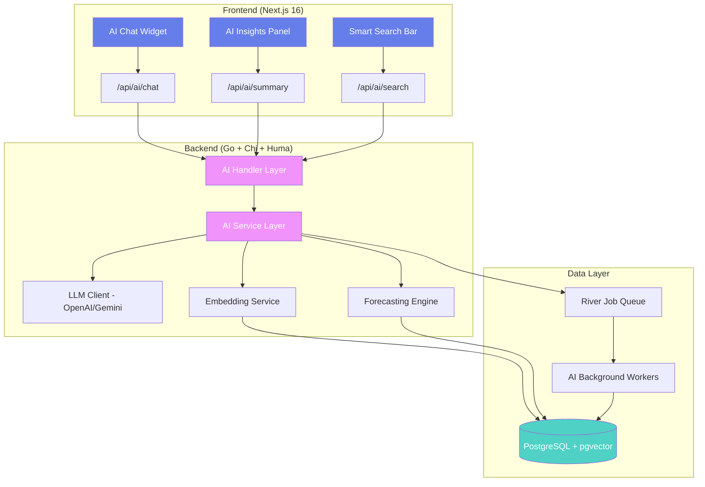

# 🤖 แผนการนำ AI เข้าสู่ระบบ UMS กรมประมง

> **สถานะ**: Proof of Concept (PoC)
> **Tech Stack ปัจจุบัน**: Go (Chi + Huma) + Next.js 16 + PostgreSQL + River + Otter Cache

---

## 📋 สรุปภาพรวม

ระบบ UMS มีข้อมูลค่าสาธารณูปโภคจาก 292 หน่วยงาน ซึ่งเป็นแหล่งข้อมูลที่ดีมากสำหรับ AI เพราะ:
- มีข้อมูล **historical billing** ย้อนหลังที่สามารถเรียนรู้ pattern ได้
- มี **audit rules** 10 ข้อที่เป็น rule-based อยู่แล้ว — AI สามารถทำได้ดีกว่า
- มี **pgvector extension** พร้อมใช้งานอยู่แล้วใน schema
- มี **River background jobs** ที่รองรับ async processing

---

## 🏗️ สถาปัตยกรรม AI Layer ที่แนะนำ



---

## 🎯 Roadmap แบ่งเป็น 4 Phase

### Phase 1: Foundation + AI Chatbot (PoC) ⬅️ **เริ่มตรงนี้**
> **เป้าหมาย**: วาง infrastructure + PoC ที่ใช้ได้จริงใน 1-2 สัปดาห์
> **คุณค่า**: ผู้ใช้สามารถถามข้อมูลค่าสาธารณูปโภคด้วยภาษาไทยธรรมชาติได้ทันที

#### ✅ สิ่งที่จะทำ

| ลำดับ | งาน | รายละเอียด |
|:---:|:---|:---|
| 1 | **สร้าง AI config** | เพิ่ม environment variables สำหรับ AI Provider (API Key, Model, etc.) |
| 2 | **สร้าง AI Service Layer** | `internal/ai/` — LLM client wrapper ที่รองรับทั้ง OpenAI / Gemini |
| 3 | **สร้าง AI Chat Handler** | `POST /api/ai/chat` — รับคำถามภาษาไทย แปลงเป็น SQL query ดึงข้อมูลตอบ |
| 4 | **System Prompt** | สอน AI ให้เข้าใจ schema ของ UMS (departments, utility_bills, budgets, audits) |
| 5 | **Chat Widget (Frontend)** | Floating chat bubble บน Next.js dashboard |

#### 🔧 โครงสร้างไฟล์ที่จะเพิ่ม

```text
backend/
├── internal/
│   └── ai/
│       ├── client.go          # LLM client (OpenAI/Gemini API wrapper)
│       ├── chat.go            # Chat service with context + SQL generation
│       ├── prompts.go         # System prompts + few-shot examples
│       └── embeddings.go      # Text → vector embedding service
├── internal/handlers/
│   └── ai.go                  # Huma API handlers: /api/ai/chat, /api/ai/search
```

```text
frontend/
└── src/
    ├── components/
    │   └── ai-chat/
    │       ├── chat-widget.tsx     # Floating chat bubble
    │       ├── chat-message.tsx    # Message bubble component
    │       └── chat-input.tsx      # Input with Thai language support
    └── lib/api/
        └── ai-hooks.ts            # TanStack Query hooks for AI endpoints
```

#### 💬 ตัวอย่างการใช้งาน Chat

```
ผู้ใช้: "เดือนนี้ค่าไฟทั้งกรมเท่าไหร่?"
AI: "ค่าไฟฟ้าประจำเดือน ต.ค. 2569 ทั้งกรมประมง รวมทั้งสิ้น 1,245,680.50 บาท
     จาก 292 หน่วยงาน โดย:
     • เบิกจ่ายแล้ว: 890,430.00 บาท (71.5%)
     • ค้างชำระ: 355,250.50 บาท (28.5%)
     💡 แนะนำ: เร่งรัดการเบิกจ่ายหน่วยงานที่ค้างชำระ 5 อันดับแรก"

ผู้ใช้: "หน่วยงานไหนค่าไฟสูงผิดปกติ?"
AI: "พบ 3 หน่วยงานที่ค่าไฟสูงผิดปกติ (>30% จากค่าเฉลี่ย):
     1. ศพช.สงขลา — 45,230 บาท (สูงกว่าค่าเฉลี่ย 42%)
     2. สนง.ประมง จ.เชียงใหม่ — 38,900 บาท (สูงกว่า 35%)
     3. ศพท.ระยอง — 51,200 บาท (สูงกว่า 31%)"
```

---

### Phase 2: AI Anomaly Detection + Auto-Summary
> **เป้าหมาย**: ปรับปรุง audit engine ด้วย ML + สรุปรายงานอัตโนมัติ

| งาน | รายละเอียด |
|:---|:---|
| **Smart Anomaly Detection** | เพิ่ม ML-based anomaly detection ใน `audit_engine.go` — ใช้ statistical model (Z-score, IQR) + LLM เพื่อตรวจจับ pattern ที่ rule-based ทำไม่ได้ |
| **Monthly AI Summary** | River background job ที่สร้างรายงานสรุปประจำเดือนอัตโนมัติ พร้อมคำแนะนำ |
| **Anomaly Explanation** | AI อธิบายเหตุผลของ anomaly แต่ละรายการเป็นภาษาไทยให้ auditor เข้าใจง่าย |
| **Dashboard AI Insights** | เพิ่ม panel บน dashboard แสดง AI-generated insights ประจำวัน |

#### 📊 ตัวอย่าง AI Monthly Summary

```
📋 สรุปค่าสาธารณูปโภค กรมประมง — เดือน ต.ค. 2569

🔑 ประเด็นสำคัญ:
1. ค่าไฟฟ้าเพิ่มขึ้น 12% จากเดือนก่อน — ตรงกับช่วงฤดูร้อน
2. พบ 15 รายการผิดปกติ (เพิ่มจาก 8 รายการเดือนก่อน)
3. หน่วยงาน 23 แห่งยังไม่ส่งบิลประจำเดือน

💡 คำแนะนำ:
• เร่งรัดหน่วยงานที่ค้างส่งบิล > 2 เดือน (มี 5 หน่วยงาน)
• ตรวจสอบ ศพช.สงขลา — ค่าไฟพุ่งสูงผิดปกติ 3 เดือนติด
• งบประมาณคงเหลือ < 20% ในหมวดค่าประปา — อาจต้องของบเพิ่ม
```

---

### Phase 3: AI-Powered Search + Auto-Categorization
> **เป้าหมาย**: ค้นหาด้วยภาษาธรรมชาติ + จัดหมวดหมู่อัตโนมัติ

| งาน | รายละเอียด |
|:---|:---|
| **Semantic Search** | ใช้ pgvector เก็บ embeddings ของบิลและหน่วยงาน ค้นหาด้วยภาษาธรรมชาติ |
| **Auto-Categorization** | AI ตรวจสอบและจัดหมวดหมู่บิลใหม่อัตโนมัติ (utility_type, budget_code) |
| **Document Understanding** | OCR + AI อ่านใบแจ้งหนี้ที่อัปโหลดและกรอกข้อมูลอัตโนมัติ |

#### 🔍 ตัวอย่าง Semantic Search

```
ผู้ใช้: "บิลค่าไฟที่ยังไม่ได้จ่ายของสำนักงานประมงภาคใต้"
→ AI ค้นหาด้วย embedding similarity แทน exact keyword match
→ ได้ผลลัพธ์ครอบคลุมทุกสำนักงานในภาคใต้ แม้ชื่อจะเขียนต่างกัน
```

---

### Phase 4: AI Forecasting
> **เป้าหมาย**: พยากรณ์ค่าใช้จ่ายล่วงหน้า

| งาน | รายละเอียด |
|:---|:---|
| **Expense Forecasting** | ใช้ historical data + time series model คาดการณ์ค่าใช้จ่ายเดือนหน้า |
| **Budget Planning** | AI แนะนำการจัดสรรงบประมาณตาม pattern การใช้จ่ายจริง |
| **Alert Prediction** | คาดการณ์ล่วงหน้าว่าหน่วยงานใดจะมี anomaly |

---

## 🛠️ AI Provider Comparison

เนื่องจากยังไม่แน่ใจ provider ผมสรุปเปรียบเทียบให้:

| เกณฑ์ | OpenAI (GPT-4o-mini) | Google Gemini 2.0 Flash | Anthropic Claude Haiku |
|:---|:---|:---|:---|
| **ราคา** | $0.15/1M input | **$0.075/1M input** ✅ | $0.25/1M input |
| **ภาษาไทย** | ดีมาก ✅ | ดีมาก ✅ | ดี |
| **Speed** | เร็ว | **เร็วที่สุด** ✅ | เร็ว |
| **Function Calling** | ดีเยี่ยม ✅ | ดี | ดี |
| **Go SDK** | `sashabaranov/go-openai` | `google/generative-ai-go` | `anthropics/anthropic-sdk-go` |
| **SQL Generation** | ดีเยี่ยม ✅ | ดี | ดีมาก |

> [!TIP]
> **แนะนำ**: เริ่มด้วย **Gemini 2.0 Flash** เพราะราคาถูกที่สุดและเร็วมาก เหมาะกับ PoC ทุกอย่างจะถูกห่อด้วย abstraction layer ที่เปลี่ยน provider ได้ทีหลัง

---

## ⚡ Quick Start — เริ่มต้น Phase 1

เมื่อเลือก provider แล้ว ผมจะ:

1. **สร้าง `internal/ai/` package** — LLM client ที่รองรับหลาย provider
2. **สร้าง system prompt** ที่เข้าใจ schema ของ UMS + ภาษาไทย
3. **สร้าง `/api/ai/chat` endpoint** — รับคำถาม → สร้าง SQL → ดึงข้อมูล → ตอบ
4. **สร้าง Chat Widget** บน Next.js dashboard
5. **สร้าง `/api/ai/summary` endpoint** — สรุปรายงานด้วย AI

> [!IMPORTANT]
> **ต้องการจากคุณ**: API Key ของ AI Provider ที่เลือก (เก็บใน `.env`)

---

## 📁 ไฟล์ที่เกี่ยวข้องในระบบปัจจุบัน

| ไฟล์ | ทำไมเกี่ยวข้อง |
|:---|:---|
| [`audit_engine.go`](file:///d:/Desktop/go_ums/backend/internal/service/audit_engine.go) | Rule-based audit 10 ข้อ — Phase 2 จะเสริมด้วย ML |
| [`dashboard.go`](file:///d:/Desktop/go_ums/backend/internal/handlers/dashboard.go) | Dashboard KPIs — จะเพิ่ม AI insights panel |
| [`reports.go`](file:///d:/Desktop/go_ums/backend/internal/handlers/reports.go) | Reports — จะเพิ่ม AI auto-summary |
| [`schema.sql`](file:///d:/Desktop/go_ums/backend/db/schema.sql) | Database schema — ใช้เป็น context ให้ AI |
| [`worker.go`](file:///d:/Desktop/go_ums/backend/internal/worker/worker.go) | River workers — จะเพิ่ม AI background jobs |
| [`bills.go`](file:///d:/Desktop/go_ums/backend/internal/handlers/bills.go) | Bill handlers — จะเพิ่ม AI categorization |
